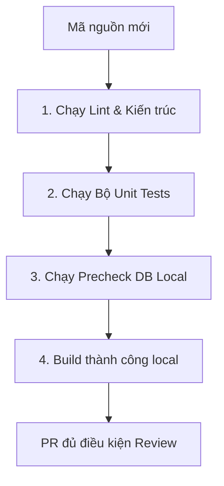

# QUY CHUẨN KỸ THUẬT & UI/UX THỐNG NHẤT — KSNK BV103

> **Phiên bản:** 1.0 (20/05/2026)  
> **Trạng thái:** Hoạt động (SSOT Phát triển Lập trình & UI/UX)  
> **Được hợp nhất từ:** Các quy chuẩn kỹ thuật, phát triển và giao diện cũ (`development-guide.md`, `DEVELOPMENT_PROCESS.md` và các quy chuẩn kỹ thuật cũ); 19/11/2026 gộp thêm `lean-execution`, `governance-pipeline`, `read-minimum` (§4–6). Bản gốc: `git show 3312cfe8:docs/core/<tên>.md`.

---

## 1. Quy chuẩn Lập trình (Engineering Standards)

Hệ thống KSNK BV103 được xây dựng dựa trên Next.js App Router (Next 16) + React 19 + TypeScript + Supabase. Để đảm bảo chất lượng, mọi lập trình viên và AI bắt buộc phải tuân thủ các quy tắc lập trình sau:

### 1.1 Nguyên tắc Thiết kế Module (DDD Boundaries)
* Mỗi phân hệ nghiệp vụ lâm sàng nằm trọn vẹn trong một thư mục dưới `src/modules/<ten-module>/`.
* **Không** import trực tiếp `actions/*` / `hooks/*` giữa hai module nghiệp vụ. Giao tiếp qua `contexts/<context>/entrypoint.ts` (CSSD), [`@/lib/mdm-read-gateway`](../../src/lib/mdm-read-gateway.ts) (GSC → bảng kiểm), [`@/lib/analytics/filter-helpers`](../../src/lib/analytics/filter-helpers.ts) (filter payload dùng chung dashboard).
* **SSOT dụng cụ:** định nghĩa master → `quan-tri-he-thong/danh-muc`; ledger vận hành → `fact_kho_dung_cu_giao_dich`.

### 1.2 Phân quyền Chặt chẽ tại Server Actions
* **Không bao giờ tin tưởng Client**: Mọi logic ghi/sửa dữ liệu ở phía Server Actions bắt buộc phải được bọc qua lớp kiểm tra quyền hạn `verifyPermission` hoặc `verifyPermissions`.
* Cú pháp mẫu kiểm tra quyền:
```typescript
import { verifyPermission } from "@/lib/server-permission";

export async function actionGhiNghiepVu(payload: InputSchema) {
  // Gate kiểm tra quyền trước khi truy cập database
  await verifyPermission("QUYEN_GHI_NGHIEP_VU");
  
  // Tiến hành ghi dữ liệu...
}
```

### 1.3 Phòng tránh Sụt giảm Hiệu năng Database
* **Không quét bảng không giới hạn**: Cấm viết các câu lệnh truy vấn dữ liệu thực tế từ các bảng `fact_*` khổng lồ mà không chỉ định giới hạn số dòng.
* Bắt buộc sử dụng `.limit()` hoặc `.range()` trên Supabase client để phân trang dữ liệu, bảo vệ bộ nhớ máy chủ Next.js và DB.

---

## 2. Hướng dẫn UI/UX và Layout Primitives (Chống Trôi lệch Giao diện)

SSOT hình ảnh: [`docs/reference/guides/bv103-visual-language.md`](../reference/guides/bv103-visual-language.md) · IA: [`docs/ux/principles.md`](../ux/principles.md) · **chrome L1:** [`docs/reference/architecture/page-chrome-contract-20260731.md`](../reference/architecture/page-chrome-contract-20260731.md) · tokens `src/lib/bv103-design-tokens.ts`.

### 2.1 Cấu trúc Layout Chuẩn (module-first)

* Font / radius / surface: theo `globals.css` + design tokens (không tự thêm stack font/poster UI).
* Mọi trang authenticated nằm trong `KsnkPageShell` (`max-w-7xl`) — **cấm** thêm `max-w-5/6/7xl` trong view.
* **L1 dưới App Header = một `KsnkPageChrome`** (title/actions → tabs → filters). Không sticky kép tiêu đề; không border-b vs card lệch mật độ.
* Chọn **đúng một** vai trò trang (Ops / Analytics / Admin) — header qua chrome chung (`KsnkSupervisionHero` / `Bv103AnalyticsPageFrame` / `KsnkPageHeader` là wrapper).
* Banner ngữ cảnh: `KsnkContextBanner` (không invent box màu riêng trừ trạng thái máy/mẻ CSSD).
* Density: `--radius-shell` + `pageChromeShell`; tránh stack card dày trên Command Center.

### 2.2 Quy định Thiết kế Form và Empty State
* **Empty State đồng nhất:** Khi không có dữ liệu, dùng `EmptyState` (hoặc empty panel token) + CTA nhập liệu — không để viewport trống.
* **Loading Fallbacks:** Widget RPC / analytics bọc skeleton hoặc `Suspense` — không chặn cả trang.
* Gate: `npm run layout:drift-check` · `npm run layout:typography-check`.

---

## 3. Quy trình Phát triển & Kiểm soát Chất lượng P0 (CI/CD Gates)

Mọi Pull Request (PR) trước khi được duyệt vào nhánh chính bắt buộc phải đi qua các cổng kiểm soát kỹ thuật nghiêm ngặt:



### 3.1 Bộ lệnh kiểm tra cục bộ (Local Command Pack)
Trước khi tạo PR, chạy **một lệnh** (full gate — khớp CI):

```bash
npm run verify
```

Tương đương: `lint` + `verify:cssd` (arch + import MDM + tests CSSD) + `verify:engineering` + `build`.

Chỉ khi chắc không đụng Server Action / DB: `npm run verify:quick` (= build).

Bổ sung khi đụng schema: `npm run verify:mdm:local`, `npm run trial:db:precheck:local`. Chi tiết: §4 bên dưới.

### 3.2 Quy trình Sử dụng PR Template
Khi tạo Pull Request trên GitHub, lập trình viên bắt buộc phải sử dụng [`.github/pull_request_template.md`](../../.github/pull_request_template.md), điền đầy đủ mô tả kịch bản kiểm thử lâm sàng bằng tay, và xác nhận hoàn thành phần **Alignment Check** (ánh xạ nghiệp vụ dữ liệu).

---

## 4. Thực thi một lát (LEAN)

Checklist PR và lệnh verify. Cổng tài liệu: [`../README.md`](../README.md).

### 4.1 Một nhịp (vertical slice)

1. Chọn **một** mảnh (module + luồng UI rõ).
2. Đọc tối thiểu: §6 bên dưới.
3. Implement surgical — mỗi dòng diff truy vết được yêu cầu (CLAUDE.md §Kỷ luật).
4. Verify theo bảng §4.3 → Pilot DoD §4.2.

### 4.2 Pilot DoD (xong task)

| # | Tiêu chí |
|---|----------|
| 1 | Người dùng / môi trường (pilot, role) xác định |
| 2 | ≥3 kịch bản tay trên UI (hoặc RPC) cho luồng vừa sửa |
| 3 | Migration/RPC apply đúng nếu đụng schema (Không db push lên prod — migration prod đi qua Lead/MCP (`apply_migration`); local: `npm run mdm:migrate:local`.) |
| 4 | Lệnh verify phù hợp pass (không chỉ `build`) |

### 4.3 Lệnh verify

| Loại thay đổi | Trước push (local) | CI tương đương |
|---------------|-------------------|----------------|
| Mặc định / PR | `npm run verify` (= full gate) | job `verify` |
| Chỉ UI nhỏ, không action | `npm run verify:quick` | — |
| Server Action / `fact_*` | `npm run verify:engineering` tối thiểu | `verify:engineering` |
| CSSD module | + `npm run verify:cssd` | lint cssd-arch + tests |
| MDM / migration | + `npm run verify:mdm` sau migrate; `npm run db:dung` dựng cả chuỗi | `db-dung.yml` |
| Ship pilot DB | `npm run pilot:ship` | — |
| Go-live gate | `npm run pilot:go-live:gate` | DB + auth + verify + smoke |

**Lưu ý:** `verify:quick` chỉ `build` — không thay PR checklist.

### 4.4 Checklist PR

- [ ] Đúng module; không vi phạm CSSD vs MDM ([`implementation-mapping.md`](implementation-mapping.md))
- [ ] `UI → Action → DB` khớp mapping; quyền qua `verifyPermission`
- [ ] Không dead link doc; nếu đổi bảng SSOT → dòng changelog trong mapping
- [ ] `npm run verify` pass (hoặc `verify:full` tương đương)
- [ ] Đã chạy tay ≥1 luồng chính trên UI

### 4.5 Boy Scout vs Surgical

- **Surgical:** không refactor file lân cận / audit cả repo.
- **Boy Scout:** chỉ file đang sửa — xóa orphan do diff của bạn, đặt tên rõ hơn trong cùng function.

---

## 5. Schema & ship (migration → CI)

Tóm tắt vận hành; chi tiết: [`operations-sop.md`](operations-sop.md).

### 5.1 Migration mới

1. Tên file: `YYYYMMDDHHMMSS_<mo_ta_ngan>.sql` (không rename file đã apply).
2. **Migration đã có trong repo là bất biến** (PO 19/11): không sửa, không xóa; muốn đổi thì viết migration mới. `scripts/guard-migrations.mjs --bat-bien` so với nhánh gốc. Một lát có tối đa 1 migration.
3. FK mới → index (rule `migrations.md`; skill `supabase-postgres-best-practices`).
4. Local: `npm run mdm:migrate:local` → `npm run verify:mdm:local`; dựng cả chuỗi từ đầu: `npm run db:dung`.
5. Remote pilot: theo SOP — không SQL nóng tùy tiện.
6. Cập nhật [`implementation-mapping.md`](implementation-mapping.md) changelog nếu đổi SSOT bảng/cột.

### 5.2 App ↔ Database sync

| Bước | Lệnh / việc |
|------|-------------|
| Push schema | Không db push lên prod — migration prod đi qua Lead/MCP (`apply_migration`); local: `npm run mdm:migrate:local`. |
| Gate MDM | `npm run verify:mdm` |
| Gate app contract | `npm run verify:engineering` |
| Ship pilot | `npm run pilot:ship` |

### 5.3 PR / CI

- CI hard (`verify`): `lint` + `lint:cssd-architecture` + `test:coverage` (report-only, **không** gate % toàn repo) + `verify:engineering` + `build`
- Workflow `db-dung.yml` (push `integrate/**` + PR): dựng Supabase local + cả chuỗi migration, `audit:views`, `db lint` không vượt mốc `scripts/data/db-lint-baseline.json`, kiểm migration bất biến
- CI soft (không chặn merge): `npm-audit-advisory` (Step Summary ghi ADVISORY khi còn CVE), `dead-code:scan` warn-only, E2E SKIP nếu thiếu secrets
- Local khuyến nghị: `npm run verify` (= `verify:full`)
- Honesty: không đặt tên bước CI kiểu «Coverage ≥80%» khi `vitest` không có `thresholds` (ENG-CI-01)

### 5.4 Doc governance

- `npm run docs:links:check` — link trong rules + `docs/`
- SSOT narrative: [`docs/README.md`](../README.md)

---

## 6. Đọc tối thiểu theo loại thay đổi

Cửa: [`../../CLAUDE.md`](../../CLAUDE.md) (ssot-map → `/domain-slice` → handover §5 → file lát). Bảng dưới là đọc thêm theo loại diff — không thay cửa.

| Loại diff | Đọc bắt buộc | Tra cứu thêm |
|-----------|--------------|--------------|
| Bất kỳ | `CLAUDE.md`, skill module trong `.claude/skills/` | [`implementation-mapping.md`](implementation-mapping.md) |
| UI layout / shell | [`wiki/concepts.md`](../wiki/concepts.md#layout-primitives) · [`page-chrome-contract-20260731.md`](../reference/architecture/page-chrome-contract-20260731.md) khi đụng shell/chrome | §2 |
| Server Action / `fact_*` | [`operations-sop.md`](operations-sop.md) § Auth/RLS | `verify:engineering` |
| Migration / RPC / view | [`operations-sop.md`](operations-sop.md) § DB + §5 | rule `migrations.md` |
| CSSD workflow / QR / mẻ / dụng cụ | [`domain-specification.md`](domain-specification.md) §2.2 + [`modules/cssd/domain-overview.md`](../modules/cssd/domain-overview.md) + mapping § CSSD · quyết định Phase 0 [`domain-decisions-cssd-instrument.md`](domain-decisions-cssd-instrument.md) | [`modules/cssd/README.md`](../modules/cssd/README.md) · rule `cssd.md` |
| MDM / danh mục / import | [`domain-specification.md`](domain-specification.md) (MDM) + rule `mdm.md` | [`modules/mdm/README.md`](../modules/mdm/README.md) · [`reference/guides/json-import-export.md`](../reference/guides/json-import-export.md) |
| Giám sát VST/GSC | [`domain-specification.md`](domain-specification.md) (Giám sát) | [`modules/giam-sat/README.md`](../modules/giam-sat/README.md) · rule `giam-sat.md` |
| NKBV | [`modules/nkbv/README.md`](../modules/nkbv/README.md) | rule `nkbv.md` |
| QLCV | mapping § Công việc | [`modules/qlcv/19-QLCV-DOMAIN-SSOT.md`](../modules/qlcv/19-QLCV-DOMAIN-SSOT.md) · rule `qlcv.md` |
| Bảng kiểm template | [`modules/giam-sat/bang-kiem-overview.md`](../modules/giam-sat/bang-kiem-overview.md) | rule `giam-sat.md` |
| Dashboard / RPC báo cáo | [`modules/dashboard/README.md`](../modules/dashboard/README.md) · [`metric-dictionary.md`](../modules/dashboard/metric-dictionary.md) | rule `dashboard.md` |
| Đào tạo / thi MCQ | [`modules/dao-tao/domain-overview.md`](../modules/dao-tao/domain-overview.md) | rule `dao-tao.md` |
| RBAC / tài khoản | [`operations-sop.md`](operations-sop.md) | `permission-registry.ts` |
| Chỉ refactor thuần (lib) | mapping cột liên quan | module README nếu đổi hành vi |

**Không** mở [`data/`](../data/) trừ khi chạy script seed. Không mở `_agent-*` hay CDC/NHSN thô khi sửa code. Lịch sử cũ tra cứu qua git log.

**Khám phá / câu hỏi tổng hợp:** [`../wiki/entities.md`](../wiki/entities.md) — không thay bảng trên khi sửa code.
